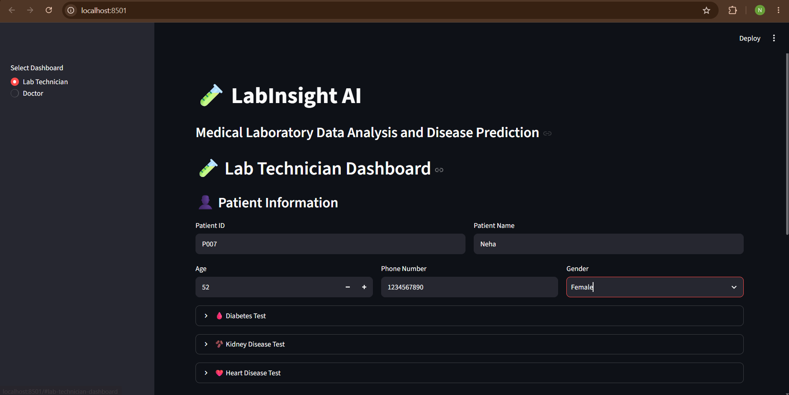
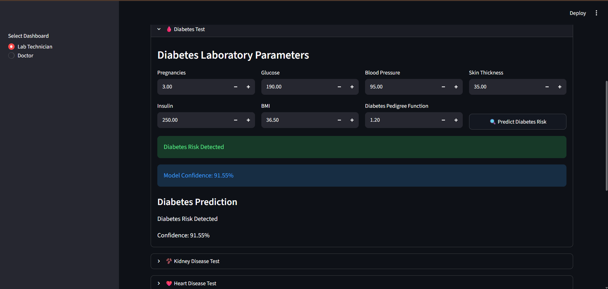
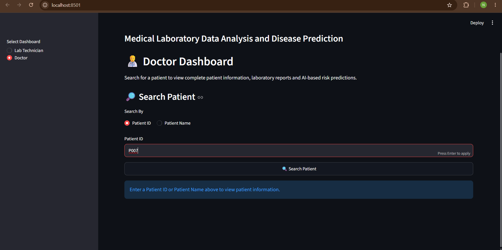
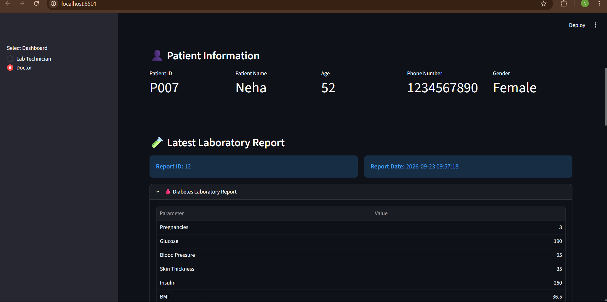

# 🧪 LabInsight AI

## Medical Laboratory Data Analysis and Explainable AI Disease Prediction Platform

**LabInsight AI** is an intelligent medical laboratory decision-support platform developed as a final-year engineering project. It bridges the gap between laboratory diagnostics and clinical decision-making by organizing patient laboratory records, calculating multi-disease risk predictions using machine learning models, explaining model outputs via SHAP (SHapley Additive exPlanations), and compiling downloadable clinical reports.

---

## 📌 Project Objectives

1. **Centralized Laboratory Records**: Maintain persistent, structured electronic laboratory records for patients across multiple visits using SQLite.
2. **Dual-Role Workflows**: Provide purpose-built, dedicated dashboards for **Laboratory Technicians** (specimen data entry, patient registration, prediction execution) and **Doctors** (patient lookup, multi-panel diagnostic review, explainability analysis, PDF generation).
3. **Multi-Disease Risk Screening**: Apply scikit-learn machine learning pipelines to detect risk across three common pathologies:
   - 🩸 **Type 2 Diabetes Mellitus**
   - 🫘 **Chronic Kidney Disease (CKD)**
   - ❤️ **Cardiovascular (Heart) Disease**
4. **Explainable AI (XAI)**: Demystify algorithmic predictions by quantifying feature attributions using SHAP linear explanation theory, visually communicating biomarker influence to clinicians.
5. **Standardized Clinical Reporting**: Dynamically compile diagnostic findings, risk stratifications, and biomarker contributions into downloadable, publication-grade PDF clinical summary documents.

---

## 🏗️ System Architecture & Workflow

```text
+---------------------------------------------------------------------------------+
|                                 LABINSIGHT AI                                   |
+---------------------------------------------------------------------------------+
                                         |
         +-------------------------------+-------------------------------+
         |                                                               |
         v                                                               v
+-----------------------------------+           +-----------------------------------+
|     LAB TECHNICIAN DASHBOARD      |           |         DOCTOR DASHBOARD          |
|-----------------------------------|           |-----------------------------------|
| * Patient Registration & Auto-ID  |           | * Patient Lookup & Disambiguation |
| * Clinical Data Entry (3 Panels)  |           | * Active & Historical Reports     |
| * Multi-Disease Prediction Run    |           | * AI Risk & Confidence Metrics    |
| * Atomic Database Persistence     |           | * SHAP Feature Attribution Chart  |
| * Instant PDF Verification        |           | * Downloadable Summary PDF        |
+-----------------------------------+           +-----------------------------------+
         |                                                               ^
         v                                                               |
+------------------------------------------------------------------------+--------+
|                          PERSISTENCE & MODEL ENGINE                             |
|---------------------------------------------------------------------------------|
| * SQLite Database (`database/labinsight.db` - 52 attributes, indexed queries)   |
| * Scikit-Learn Pipelines: Imputer -> Scaler/OneHot -> Regularized Classifier    |
| * SHAP Linear Explainer (`modules/shap_explainer.py`)                           |
| * ReportLab PDF Engine (`modules/report_generator.py`)                          |
+---------------------------------------------------------------------------------+
```

---

## 🔬 Machine Learning Models & Provenance

All models are trained using scikit-learn pipelines with cross-validation and strict train/test split hygiene to eliminate data leakage.

### 1. Diabetes Mellitus Model
- **Dataset**: Pima Indians Diabetes Database (`data/raw/diabetes.csv`, 768 samples, 8 features).
- **Pipeline Architecture**:
  - `SimpleImputer(strategy="median")`
  - `StandardScaler()`
  - `LogisticRegression(max_iter=1000)`
- **Input Features (8)**: `Pregnancies`, `Glucose`, `BloodPressure`, `SkinThickness`, `Insulin`, `BMI`, `DiabetesPedigreeFunction`, `Age`.
- **Held-Out Test Performance (20% Stratified Test Split, n=154)**:
  - Accuracy: **71.43%**
  - Precision: **60.87%**
  - Recall: **51.85%**
  - F1-Score: **0.5600**
  - ROC-AUC: **0.8230**

### 2. Chronic Kidney Disease (CKD) Model
- **Dataset**: UCI Chronic Kidney Disease Dataset (`data/raw/kidney_disease.csv`, 400 samples, 24 features).
- **Pipeline Architecture**:
  - Numeric Transformer: `SimpleImputer(strategy="median")` -> `StandardScaler()`
  - Categorical Transformer: `SimpleImputer(strategy="most_frequent")` -> `OneHotEncoder(handle_unknown="ignore")`
  - Classifier: `LogisticRegression(max_iter=2000)`
- **Input Features (24)**: `age`, `bp`, `sg`, `al`, `su`, `rbc`, `pc`, `pcc`, `ba`, `bgr`, `bu`, `sc`, `sod`, `pot`, `hemo`, `pcv`, `wc`, `rc`, `htn`, `dm`, `cad`, `appet`, `pe`, `ane`.
- **Held-Out Test Performance (20% Stratified Test Split, n=80)**:
  - Accuracy: **100.0%**
  - Precision: **100.0%**
  - Recall: **100.0%**
  - F1-Score: **1.0000**
  - ROC-AUC: **1.0000**

### 3. Heart Disease Model
- **Dataset**: Cleveland Heart Disease Dataset (`data/raw/heart_disease.csv`, 303 samples, 13 features).
- **Pipeline Architecture**:
  - `SimpleImputer(strategy="median")`
  - `StandardScaler()`
  - `LogisticRegression(max_iter=2000)`
- **Input Features (13)**: `age`, `sex`, `cp`, `trestbps`, `chol`, `fbs`, `restecg`, `thalach`, `exang`, `oldpeak`, `slope`, `ca`, `thal`.
- **Held-Out Test Performance (20% Stratified Test Split, n=61)**:
  - Accuracy: **80.33%**
  - Precision: **76.92%**
  - Recall: **90.91%**
  - F1-Score: **0.8333**
  - ROC-AUC: **0.8690**

---

## 🔍 Explainable AI (SHAP) Integration

In clinical diagnostics, "black box" machine learning models are unacceptable. LabInsight AI implements **SHAP (SHapley Additive exPlanations)** based on game-theoretic Shapley values:

- **Mathematical Meaning**: Quantifies the positive or negative contribution of each biomarker to the model's log-odds output relative to the expected reference value.
- **Directional Visualization**:
  - 🟩 **Positive Impact (Green)**: Biomarker elevates the model's predicted disease risk score.
  - 🟥 **Negative Impact (Red)**: Biomarker decreases the model's predicted disease risk score.
- **Reference Zero-Line**: Displays a dashed baseline rule for clear attribution interpretation.
- **Scientific Caveat**: SHAP values explain *algorithmic model mechanics* and statistical feature importance; they do not establish biological etiology or medical causation.

---

## 📂 Project Directory Structure

```text
LabInsight_AI/
│
├── app.py                      # Main Streamlit web application entry point
├── migrate_db.py               # Standalone database migration utility
├── train_model.py              # Diabetes model training pipeline script
├── train_kidney_model.py       # Kidney CKD model training pipeline script
├── requirements.txt            # Python dependencies with locked versions
├── README.md                   # Comprehensive project documentation
│
├── data/
│   └── raw/
│       ├── diabetes.csv        # Pima Indians diabetes dataset
│       ├── kidney_disease.csv  # UCI chronic kidney disease dataset
│       └── heart_disease.csv   # Cleveland heart disease dataset
│
├── database/
│   ├── schema.sql              # Clean SQLite schema definition with indexes
│   └── labinsight.db           # Persistent SQLite database
│
├── models/
│   ├── diabetes_model.pkl      # Serialized scikit-learn diabetes pipeline
│   ├── kidney_model.pkl        # Serialized scikit-learn kidney pipeline
│   └── heart_model.pkl         # Serialized scikit-learn heart pipeline
│
├── modules/
│   ├── __init__.py             # Module initialization
│   ├── database.py             # Database CRUD, connection & migration logic
│   ├── technician.py           # Lab Technician dashboard UI & workflows
│   ├── doctor.py               # Doctor dashboard UI & analytical views
│   ├── prediction.py           # ML inference wrappers for all 3 models
│   ├── shap_explainer.py       # SHAP explanation calculation engine
│   ├── report_generator.py     # ReportLab clinical PDF generator
│   ├── utils.py                # Reference ranges, units, and validators
│   ├── test_shap.py            # Standalone SHAP verification script
│   └── train_heart_model.py    # Heart disease model training pipeline script
│
├── notebooks/
│   └── eda.ipynb               # Exploratory data analysis notebook
│
├── reports/                    # Directory for generated PDF clinical reports
│
├── screenshots/                # Application UI demonstration screenshots
│   ├── home-lab-technician.png
│   ├── diabetes-prediction.png
│   ├── doctor-dashboard.png
│   └── patient-report.png
│
└── tests/                      # Automated unit and integration test suite
    ├── run_all_tests.py        # Master test runner
    ├── test_database.py        # Database operations & migrations tests
    ├── test_prediction.py      # ML models & feature order tests
    ├── test_shap.py            # SHAP attribution & validation tests
    ├── test_report_generator.py# PDF document generation tests
    └── test_integration.py     # End-to-end technician -> doctor workflow test
```

---

## 🛠️ Technology Stack

- **Core Programming Language**: Python 3.11
- **Web Application Framework**: Streamlit
- **Machine Learning & Preprocessing**: Scikit-Learn, NumPy, Pandas, Joblib
- **Explainable AI (XAI)**: SHAP (SHapley Additive exPlanations)
- **Data Visualization**: Altair, Matplotlib
- **Document Generation**: ReportLab 5.0.0 (Clinical PDF generation)
- **Database**: SQLite3 (Embedded relational database)
- **Quality Assurance**: Python `unittest` framework (22 automated test suites)

---

## 🚀 Installation & Setup Instructions

### Prerequisites
- Windows 10/11, macOS, or Linux
- Python 3.10 or 3.11 installed

### 1. Clone the Repository
```bash
git clone https://github.com/shruti-jadhav1712/LabInsight_AI-Shruti-Final.git
cd LabInsight-AI
```

### 2. Create and Activate Virtual Environment
```bash
# On Windows
python -m venv venv
.\venv\Scripts\activate

# On macOS / Linux
python3 -m venv venv
source venv/bin/activate
```

### 3. Install Dependencies
```bash
pip install -r requirements.txt
```

### 4. Run Automated Test Suite
Verify that all system components, models, database schemas, and PDF generators pass:
```bash
python tests/run_all_tests.py
```
*Expected result: 22 passed tests in < 1 second.*

### 5. Launch the Web Application
```bash
python -m streamlit run app.py
```
Open your web browser and navigate to:
```text
http://localhost:8501
```

---

## 🧪 Automated Testing Suite

The project includes an automated test suite executed via Python's built-in `unittest` framework:

```bash
python tests/run_all_tests.py
```

### Coverage Breakdown (22 Automated Tests):
- **Database Tests (`tests/test_database.py`)**: Patient creation, lookup, name search, chronological report retrieval, prediction updates, next ID suggestion.
- **Model Tests (`tests/test_prediction.py`)**: Model deserialization, exact 8/24/13 feature order verification, prediction labels, probability bounds.
- **Explainability Tests (`tests/test_shap.py`)**: SHAP vector calculation, missing feature validation, input dimension checks, directional labeling.
- **Reporting Tests (`tests/test_report_generator.py`)**: Valid `%PDF` magic byte output, disk persistence, sparse data handling, SHAP table inclusion.
- **Integration Test (`tests/test_integration.py`)**: Complete end-to-end simulation from patient registration to doctor review, SHAP calculation, and PDF download.

---

## 📸 Application Screenshots

### Laboratory Technician Dashboard


### Diabetes Disease Prediction & SHAP


### Doctor Dashboard


### Patient Laboratory Report


---

## ⚠️ Medical & Academic Disclaimer

**LabInsight AI** is developed exclusively for academic evaluation, engineering demonstration, and educational research purposes. 

- Machine learning predictions and SHAP feature attributions represent **statistical estimations**, not clinical diagnoses.
- The platform is **not a certified medical device (SaMD)** and must not be used as a standalone diagnostic tool or for prescriptive medical treatments.
- Any clinical judgment must be exercised by a certified healthcare professional in accordance with accredited laboratory testing standards.

---

## 👤 Author & Acknowledgments

- **Author**: Shruti Jadhav
- **Degree**: Bachelor of Technology / Bachelor of Engineering in Information Technology
- **Repository**:[https://github.com/shruti-jadhav1712/LabInsight-AI-Shruti-Final)]
